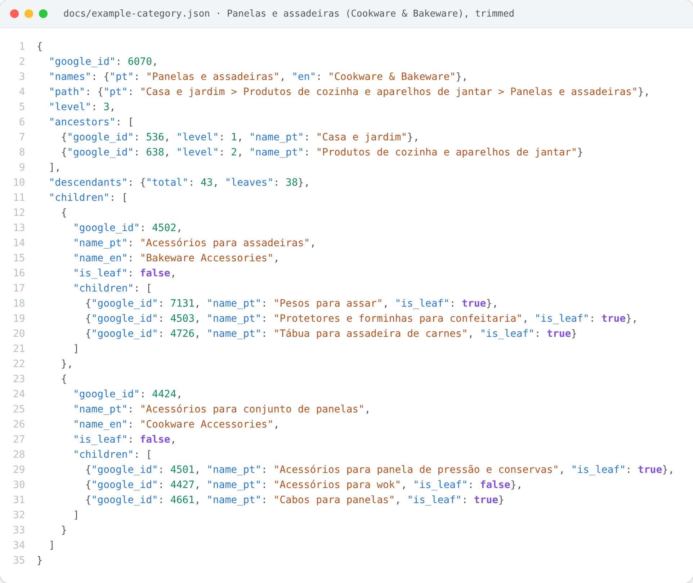
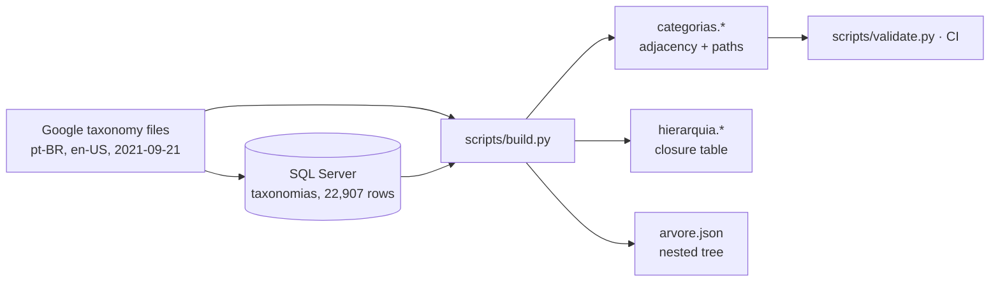

# Taxonomia de produtos do Google (pt-BR + en) · Google Product Taxonomy

[](https://github.com/CaiqueDourado/taxonomia-google-produtos-ptbr/actions/workflows/validate.yml)
[](LICENSE-DATA.md)
[](LICENSE)
[](https://www.kaggle.com/datasets/caiquedourado/taxonomia-google-produtos-ptbr)

**pt-BR:** A taxonomia de produtos do Google (Merchant Center) em português e inglês, com id oficial, categoria pai, nível e caminho completo. 5.595 categorias em três formatos: tabela, tabela de fechamento e árvore JSON.
**en:** Google's product taxonomy (Merchant Center) in Brazilian Portuguese and English, with official ids, parent ids, levels and full paths. 5,595 categories in three shapes: flat table, closure table and nested JSON tree.

[Leia em português](README.pt-BR.md)

| File | Rows | What it is |
|---|---|---|
| `categorias` (CSV · Parquet · JSON) | 5,595 | One row per category: ids, parent, level, leaf flag, PT/EN names and paths, top level, slug |
| `hierarquia` (CSV · Parquet) | 22,907 | Closure table: every (category, ancestor) pair |
| `arvore.json` | 1 tree | Nested `{id, name_pt, name_en, children}` |

Google taxonomy version **2021-09-21** (the latest published) · 21 top-level categories · up to 7 levels · 4,719 leaves.

## How a category is structured



The three files join on `google_id`. Put together for **Panelas e assadeiras** (Cookware & Bakeware, id 6070): its names and path from `categorias`, its two ancestors and its 43 descendants (38 of them leaves) from `hierarquia`, and its 5 children with their own children from `arvore.json`. Full record: [docs/example-category.json](docs/example-category.json), built by [scripts/make_json.py](scripts/make_json.py) (`python scripts/make_json.py 3329` for any other id).

## Preview

| google_id | parent_id | level | is_leaf | name_pt | name_en | slug_pt |
|---|---|---|---|---|---|---|
| 536 | | 1 | False | Casa e jardim | Home & Garden | casa-e-jardim |
| 696 | 536 | 2 | False | Decoração | Decor | casa-e-jardim/decoracao |
| 588 | 592 | 4 | True | Velas | Candles | casa-e-jardim/decoracao/fragrancias-domesticas/velas |
| 3329 | 2425 | 4 | True | Lâmpadas de LED | LED Light Bulbs | casa-e-jardim/iluminacao/lampadas/lampadas-de-led |
| 1604 | 166 | 2 | False | Roupas | Clothing | vestuario-e-acessorios/roupas |

## Use it

```python
import pandas as pd

base = "https://raw.githubusercontent.com/CaiqueDourado/taxonomia-google-produtos-ptbr/main/data/"
cat = pd.read_csv(base + "categorias.csv", dtype={"parent_id": "Int64"})
hier = pd.read_csv(base + "hierarquia.csv")

# All leaf categories under "Casa e jardim > Decoração" (google_id 696)
leaves = hier[hier.ancestor_id == 696].merge(cat, on="google_id").query("is_leaf")
print(len(leaves), leaves.path_pt.head())
```

```sql
-- Breadcrumb of "Lâmpadas de LED", top level first (DuckDB, PostgreSQL, SQL Server)
SELECT a.name_pt, a.name_en
FROM hierarquia h JOIN categorias a ON a.google_id = h.ancestor_id
WHERE h.google_id = 3329
ORDER BY h.ancestor_level;
```

Typical uses:

- **Feeds:** fill `google_product_category` in Google Shopping feeds for Brazil.
- **Translation:** map store categories between Portuguese and English.
- **Pages:** build category pages, menus and breadcrumbs.
- **Machine learning:** train product classifiers with a bilingual label set.

## How it was built



Google publishes the taxonomy as one plain-text file per language ([documentation](https://support.google.com/merchants/answer/6324436)). The author loaded the Portuguese file into SQL Server years ago to classify products crawled from Brazilian stores. That table had one row per path level, with no Google id and no parent.

This repository goes back to the official files in Portuguese and English. It:

- rebuilds the hierarchy with official ids;
- cleans the names;
- matches all 5,595 paths of the old table (`legacy_id`);
- publishes the tree in the three shapes people actually query.

Details and example queries are in [methodology](docs/methodology.md). Column by column: [data dictionary](docs/data-dictionary.md) ([pt-BR](docs/data-dictionary.pt-BR.md)).

## Data quality

Google's pt-BR file has some problems:

- non-breaking spaces inside 14 names;
- trailing spaces in 9 names;
- a double space;
- a typo (`imâs` for `ímãs`).

They break exact string matching. All of them are fixed and tested. The full report is in [data-quality.md](docs/data-quality.md).

## Repository layout

```text
data/          categorias.*, hierarquia.*, arvore.json, dataset-metadata.json (Kaggle)
raw/           Google's pt-BR and en-US files (unchanged) and the author's original table
schema/        column definitions and dataset metadata
scripts/       build.py, validate.py, docs.py
notebooks/     eda.ipynb
docs/          data dictionary, methodology, data quality
```

```bash
pip install -r requirements.txt
python scripts/build.py && python scripts/validate.py && python scripts/docs.py
```

## License

Category names and ids © Google; everything derived here is CC BY 4.0. See [LICENSE-DATA.md](LICENSE-DATA.md). Code: [MIT](LICENSE).

## Author

**Caique Dourado**: 20 years building crawlers, data pipelines and programmatic SEO for Brazilian e-commerce in .NET and SQL Server. See also [BrCommerceKit](https://github.com/CaiqueDourado/BrCommerceKit), which detects store platforms and reads Google Shopping feeds. This taxonomy was used to classify the products of [brazilian-ecommerce-products](https://github.com/CaiqueDourado/brazilian-ecommerce-products) (114.6 million offers; full data on [Kaggle](https://www.kaggle.com/datasets/caiquedourado/catalogo-produtos-ecommerce-brasil)).
