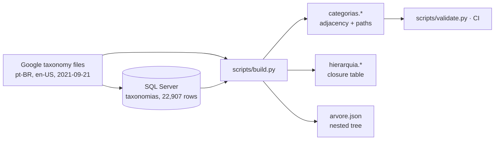

# Methodology

## 1. Origin

Google publishes its **Product Taxonomy**, the category tree that Google Merchant Center accepts in the `google_product_category` attribute, as plain text files, one per language ([documentation](https://support.google.com/merchants/answer/6324436)). The latest version is **2021-09-21**, with 5,595 categories.

The author loaded the pt-BR file into SQL Server (`taxonomia_google.dbo.taxonomias`) to classify products crawled from Brazilian stores. That table, kept in `raw/taxonomias.csv`, stores **one row per level of each path**: 22,907 rows for 5,595 categories. It has no Google id and no parent id. Its columns:

| # | Column | Meaning |
|---|---|---|
| 1 | `id` | Row id |
| 2 | `idTaxonomiaRaw` | Path number in the loaded file (1–5,595), right-padded with spaces |
| 3 | `taxonomia` | Name of the level |
| 4 | `pos` | Level position in the path (1 = top) |
| 5 | `totalPosicoes` | Depth of the path |

## 2. Rebuilding the tree with official ids

The official files with ids, `taxonomy-with-ids.pt-BR.txt` and `taxonomy-with-ids.en-US.txt`, are kept untouched in `raw/`. `scripts/build.py`:

1. Reads both files and checks that they share the same version and the same 5,595 ids.
2. Cleans names (non-breaking spaces, repeated and trailing spaces, one typo; see [data-quality.md](data-quality.md)).
3. Derives `parent_id` by matching each path without its last level, plus `level`, `child_count`, `is_leaf`, the top-level ancestor and a URL slug.
4. Matches every path of the author's table to an official id, so `legacy_id` links older datasets that used `idTaxonomiaRaw`. All 5,595 match.
5. Writes the tree in three shapes:

| Shape | File | Best for |
|---|---|---|
| Adjacency list + materialised path | `categorias.*` | Lookups, filters, spreadsheets |
| Closure table | `hierarquia.*` | "All descendants of X" and "all ancestors of Y" with one join, in any SQL database |
| Nested JSON | `arvore.json` | Menus, category pickers, front-end |

The author's original table turns out to be a closure table without the keys: one row per (category, ancestor). `hierarquia.csv` is the same relation with ids, distances, and the same 22,907 rows.



## 3. Example queries

```sql
-- Every leaf category under "Casa e jardim > Decoração" (DuckDB, PostgreSQL, SQL Server)
SELECT c.google_id, c.path_pt
FROM hierarquia h
JOIN categorias c ON c.google_id = h.google_id
WHERE h.ancestor_id = 696          -- Casa e jardim > Decoração
  AND c.is_leaf;

-- Breadcrumb for one category, top level first
SELECT a.name_pt
FROM hierarquia h JOIN categorias a ON a.google_id = h.ancestor_id
WHERE h.google_id = 3329 ORDER BY h.ancestor_level;
```

## 4. Validation

`scripts/validate.py` checks, on every push:

- **Ids and slugs:** the ids are unique, and so are the paths and slugs in both languages.
- **Legacy ids:** `legacy_id` covers 1–5,595.
- **Hierarchy:** there are 21 roots. Each parent exists, and each category's level is its parent's level + 1. Each path is the parent's path plus the category's own name.
- **Children:** `child_count` and `is_leaf` are correct.
- **Closure table:** it has the expected 22,907 rows and agrees with `top_level_id`.
- **Tree:** the JSON tree contains every category exactly once.
- **Spacing:** no irregular spaces are left.
